# Architecture

ClawBridge separates durable coordination data from the agent process handling it.
A workspace contains projects; each project contains sessions, messages, recipient
deliveries and an append-only audit history. Session and message IDs are immutable.

Solid boxes and lines ship in v1.0.0. The dashed grey box and dashed edges, the local web UI, are
planned and not in v1.0.0. The thick edges cross a trust boundary. "Device-signed
requests" means every request from a computer to the server carries a signature
made with that computer's device key. "HMAC webhook signature" means the server
accepts a Linear delivery only if its signature verifies with the signing secret
the operator set. "Sandbox" means the optional model engine runs in a rootless
sandbox whose only routes out, through the egress proxy, are the ClawBridge
server (at its public HTTPS address, through Caddy) and the owner's model provider.
Webhooks are optional and off by default; the watcher polls Linear, and polling
is the fallback and the record of progress. Local mode is the same bus on SQLite,
on one machine.

The diagram's source is [images/architecture-detail.mmd](images/architecture-detail.mmd); regenerate the SVG with mermaid-cli after editing it.

## Application boundary

The CLI, stdio MCP server and terminal UI use the same scoped application API.
Local mode uses SQLite and attributes calls to the OS user. Hosted mode uses
PostgreSQL behind an HTTPS API that verifies each request's device-key signature
before applying workspace membership, project permissions and session-instance
checks. (Google sign-in was removed in v1.0.)

A session's routing role describes its work. Project permissions determine what
it can do. Explicit session instances fence old processes after a resumption;
they do not authenticate separate programs running as the same local OS user.

## Message lifecycle

A send commits a message and snapshots its eligible recipients. The sender's
operation ID makes an identical retry idempotent. Inbox fetching stamps delivery;
explicit mark-read stamps reading. Neither proves agreement, task completion or
human approval. Replies retain the conversation thread and identify their parent.

Retirement records an explicit successor without forwarding messages. Expiry
controls visibility; the hosted purge operation removes expired delivery data and
blanks bodies while retaining message identity and retry tombstones.

## Notifications

The notification feature reads authoritative inbox metadata without
stamping delivery, reading, presence or audit. A subscribed MCP client receives
resource-change notices. A separately started watcher can emit JSON events or
queue a fixed inbox-check hint to an explicitly selected Codex thread. The host
controls model execution; the agent fetches message contents through its inbox.

Polling is bounded and opt-in. The checkpoint coalesces arrivals and survives
restart. An uncertain queue outcome can duplicate a hint; durable inbox/read
metadata remains the processing record. See [notifications](notifications.md).

The [coordination design](design/coordination.md) adds recipient policy to automatic notices and a separate local host observer.
Host observations never substitute for bus presence, message receipts or task
acceptance. Optional issue/revision message metadata remains descriptive; Linear
and coordinator decisions determine current ownership.

## Offline behavior

Cloud clients can explicitly sync a project-scoped read-only mirror. Supported
reads may use it during transport/service outages and clearly report their source
and freshness. Authentication/permission failures are returned directly. Writes
and notification status never fall back to a writable local authority. The one
replay is the client outbox: on a hosted server, a plain message, reply, ack or
mark-read that can't reach the server waits in this machine's outbox and is sent
once, in order, when it is back (`outcome: queued_local`); every other write
fails fast.

## Credentials and configuration

Trusted client configuration selects the authority, principal, device key and
cache. Repository configuration supplies scope only. The device's private key
stays in the native key store (or a 0600 file, by choice) and never leaves the
machine; each request is signed with it. MCP entries
contain the trusted config path and safe routing values, rather than credentials.

## Task ownership

The [native Linear connection](linear.md) provides scoped task-board actions
through CLI, TUI and the local MCP adapter; a separate official Linear MCP remains
optional for additional operations. Personal keyring profiles are separate from
the shared project-to-team/project mapping. Linear provides the task graph and
durable decisions. The
[agent task-board workflow](../skills/clawbridge/references/task-board.md) binds
an assigned slice to a ClawBridge session, resolves its dependency owners and
uses peer messages for cooperation. Coordinator assignments resolve overlapping
ownership; session labels and task notes are descriptive.

The [API reference](reference/api.md) describes requests and results. Historical
contracts and acceptance evidence are indexed in [the archive](archive/README.md).
