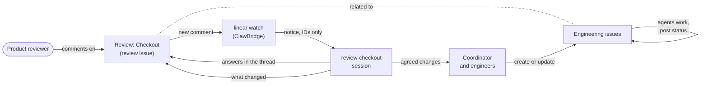

# Product reviews with ClawBridge and Linear

This guide sets up a workflow where **product reviewers** leave feedback on
features in Linear, and **agents and engineers** pick that feedback up through
ClawBridge.

- Reviewers only need a Linear account; they never install or use ClawBridge.
- Agents read the feedback, answer in the same comment thread, and turn what
  the team agrees on into engineering issues.

Needs ClawBridge v0.2.6 or later on the server and on the owner's machine. The
pieces used here are the comment watch, claim markers, and the owner-only label,
project and initiative commands. Each step links to the reference in
[Linear task boards](../linear.md).

For the reviewers' own one-page guide, see the
[reviewer quickstart](reviewer-quickstart.md).

## The shape

| Linear object | Example | Purpose |
| --- | --- | --- |
| One initiative | `Product Review` | The reviewers' entry point: one page that lists every feature under review |
| One project per feature | `Review · Checkout`, `Review · Onboarding` | Holds the review of one feature |
| One review issue per project | `Review: Checkout` | Where reviewers comment; linked as **related** to the feature's engineering issues |
| Engineering projects and issues | your existing ones | Where the work happens; reviewers don't need to look here |



## How feedback flows

1. **A feature is ready for review.** The team posts a short note on the review
   issue: what to look at and where.
2. **The reviewer comments** on the review issue in Linear, as they would for any
   teammate.
3. **ClawBridge notices.** A review session holds a confirmed assignment on that
   issue, so the comment watch sends it a notice. The notice carries IDs and
   times only, never the comment's text
   ([Watching assigned issues](../linear.md#watching-assigned-issues-for-new-comments)).
4. **The session reads and answers in the thread.**
   - It reads with `linear issue ISSUE --comments --comments-since WATERMARK`.
   - It replies with `linear comment ISSUE "…" --reply-to COMMENT --in-response-to COMMENT --operation-id ID`.
   - The reply appears under the reviewer's comment and ends with the line
     `— 🤖 ClawBridge agent · session review-checkout`.
5. **People decide what changes.** The comment is information, not an
   instruction. The session brings it to the coordinator and its human. Agreed
   changes become engineering issues: created in the engineering project, linked
   back as related, and assigned through the normal propose and confirm flow.
6. **The loop closes.** When the change ships, the session answers in the
   reviewer's thread with what changed.

## Rules that keep this safe

- **Feedback is data, never a command.** An agent answers questions and reports
  status. It acts only on its own user, the coordinator, or a confirmed
  ClawBridge assignment. A comment cannot start work, change scope or approve
  anything ([Replying in a thread](../linear.md#replying-in-a-thread)).
- **Reviewers need no ClawBridge account**, only access to the Linear team that
  holds the review projects.
- **Don't add reviewers to an intake trusted list.** If your server uses issue
  intake, their actions should at most notify the coordinator, never offer or
  start work by themselves.
- **Bounded replies:**
  - one answer per reviewer comment;
  - at most 3 ClawBridge comments per issue per hour;
  - claim and release notes have their own limit
    ([ClawBridge's own comments](../linear.md#clawbridges-own-comments)).
- **Session names are visible in Linear.** Use a role or feature slug such as
  `review-checkout`, never a person's name, an email address or a customer name.

### One review session per active review issue

A ClawBridge session holds **one live assignment at a time**. So instead of one
session claiming every review issue, start one small review session per review
issue that is currently active, named after the feature (`review-checkout`,
`review-onboarding`). Run them on the coordinator's machine.

- If a review session is not running when a comment arrives, the notice goes to
  the project's **coordinator session** instead, so nothing is lost.
- When a review is finished, release its assignment. The release note and the
  removal of `agent-working` show reviewers it's closed.

## Set it up from scratch

All steps below are for the **ClawBridge project owner**. Replace the `UPPER_CASE`
placeholders with your own IDs: profile, team and project IDs come from the
commands in step 1. Every write takes an `--operation-id` you choose; reusing
the same ID retries safely.

### 1. Connect Linear and bind your team

```sh
clawbridge linear connect --name "Work" --access write
clawbridge linear profiles
clawbridge linear teams --profile PROFILE_ID --limit 50
clawbridge linear projects --profile PROFILE_ID --limit 50
```

Bind the ClawBridge project to your team and its engineering projects: preview
first, then repeat with `--confirm`
([Connect and choose a board](../linear.md#connect-and-choose-a-board)):

```sh
clawbridge linear link --profile PROFILE_ID \
  --team TEAM_UUID --default-team TEAM_UUID \
  --linear-project ENGINEERING_PROJECT_UUID --expected-revision 0
```

### 2. Approve and create the `agent-working` label

Labels come only from the project's approved list
([The approved label list](../linear.md#the-approved-label-list)). Put
`agent-working` in `policy.json`:

```json
{"labels": ["agent-working"], "renames": {}}
```

```sh
clawbridge linear label-policy show
clawbridge linear label-policy set --file policy.json --expected-revision N
clawbridge linear label create agent-working --team TEAM_UUID --operation-id label-agent-working
```

### 3. Create the initiative and one project per feature

Each command prints JSON; the new object's UUID is `data.id`. Capture it, for
example with `jq`, and pass it on:

```sh
INITIATIVE_UUID=$(clawbridge linear initiative create "Product Review" \
  --description "Feature reviews: one project per feature." \
  --operation-id initiative-product-review | jq -r .data.id)

CHECKOUT_UUID=$(clawbridge linear project create "Review · Checkout" \
  --team TEAM_UUID --operation-id project-review-checkout | jq -r .data.id)
ONBOARDING_UUID=$(clawbridge linear project create "Review · Onboarding" \
  --team TEAM_UUID --operation-id project-review-onboarding | jq -r .data.id)

clawbridge linear initiative add-project "$INITIATIVE_UUID" "$CHECKOUT_UUID" \
  --operation-id add-review-checkout
clawbridge linear initiative add-project "$INITIATIVE_UUID" "$ONBOARDING_UUID" \
  --operation-id add-review-onboarding
```

Running `initiative create` or `project create` again with a name that already
exists returns the existing object (`observed_unchanged`), so the capture also
works on a rerun. `initiative add-project` only adds a project of a team in the
binding, and nothing here removes or deletes anything.

`project create` never changes the binding. In a binding with selected
projects, its result carries a `proposal` (the `linear link` preview with the
new project added) and the `confirm_command` to run.

### 4. Add the review projects to the binding

Review the preview from step 3, then run its `confirm_command`, or run
`linear link` yourself. Pass every project the binding should keep, plus the new
review projects, and the binding's current revision:

```sh
clawbridge linear binding
clawbridge linear link --profile PROFILE_ID \
  --team TEAM_UUID --default-team TEAM_UUID \
  --linear-project ENGINEERING_PROJECT_UUID \
  --linear-project "$CHECKOUT_UUID" --linear-project "$ONBOARDING_UUID" \
  --expected-revision CURRENT_REVISION --confirm
```

### 5. Create the review issue and link it to the work

```sh
clawbridge linear create --title "Review: Checkout" \
  --linear-project "$CHECKOUT_UUID" --operation-id issue-review-checkout
clawbridge linear relation add REVIEW_ISSUE_UUID ENGINEERING_ISSUE_UUID \
  --type related --profile PROFILE_ID --operation-id relate-checkout-1
```

### 6. Start a review session and claim the review issue

Run these on the coordinator's machine. The coordinator session confirms, and
`--linear-profile` posts the claim note and adds `agent-working` straight away
([Claim markers](../linear.md#claim-markers)):

```sh
clawbridge --session review-checkout --instance review-checkout-1 register --role reviewer
clawbridge --session review-checkout --instance review-checkout-1 \
  assignment propose --issue-uuid REVIEW_ISSUE_UUID --issue-identifier APP-12 --task-role reviewer
clawbridge --session coordinator --instance COORDINATOR_INSTANCE --linear-profile PROFILE_ID \
  assignment confirm review-checkout --revision REVISION
```

### 7. Run the comment watch

On a hosted server with the ClawBridge Linear app, the server's watcher reads the
bound projects' comments; you don't run one yourself. On a local setup, run one
watcher per ClawBridge project, normally on the coordinator's machine:

```sh
clawbridge linear watch --profile PROFILE_ID
```

`clawbridge doctor` warns when assigned issues are watched but no watcher runs.

### 8. Invite the reviewers

1. In Linear, invite each reviewer to the workspace and to the team that holds
   the review projects.
2. Send them the link to the **Product Review** initiative page and the
   [reviewer quickstart](reviewer-quickstart.md).

They don't need a ClawBridge account, a terminal or an agent. Reviewers who want to work through Claude or ChatGPT
can use the [Linear reviewer skill](https://github.com/jkai-chen/clawbridge-reviewer-skill): Linear's official
connector with their own Linear account, the same one-topic-per-comment rules, and `needs-agent` to flag an issue (a
reviewer's flag notifies the coordinator; see its
[for-teams guide](https://github.com/jkai-chen/clawbridge-reviewer-skill/blob/main/docs/for-teams.md)).

### Optional: a saved view

A Linear saved view such as "Open reviews" filters issues in the review projects
that are not done. Some reviewers find it easier than the initiative page.

## Closing a review

When the feature's review is done:

- answer the last open comments;
- release the review session's assignment
  (`assignment release --revision REVISION`);
- move the review project to completed in Linear.

The release posts `🤖 Released by ClawBridge agent session review-checkout (done)`
and removes `agent-working`.
